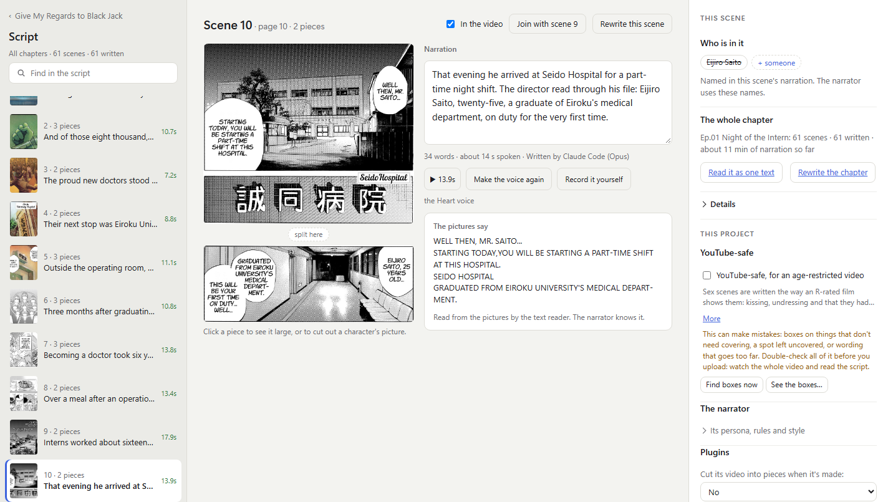
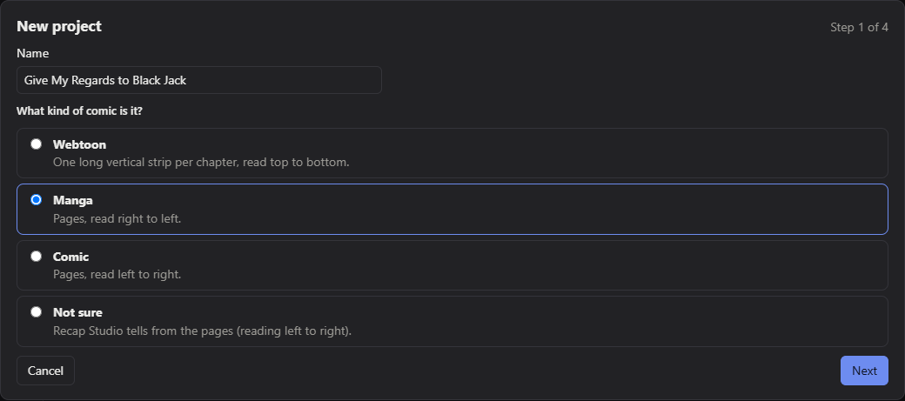
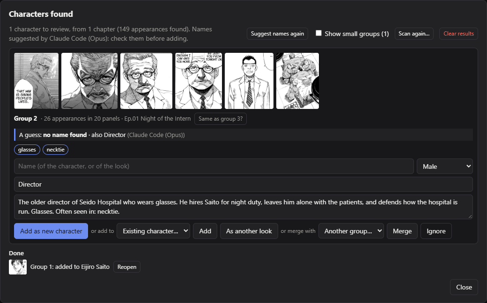
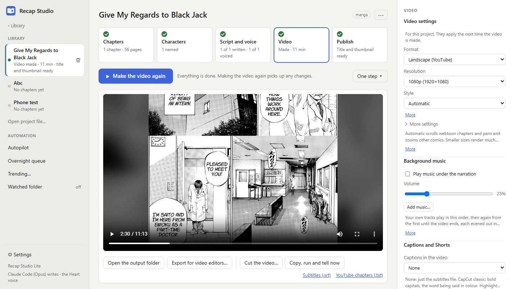
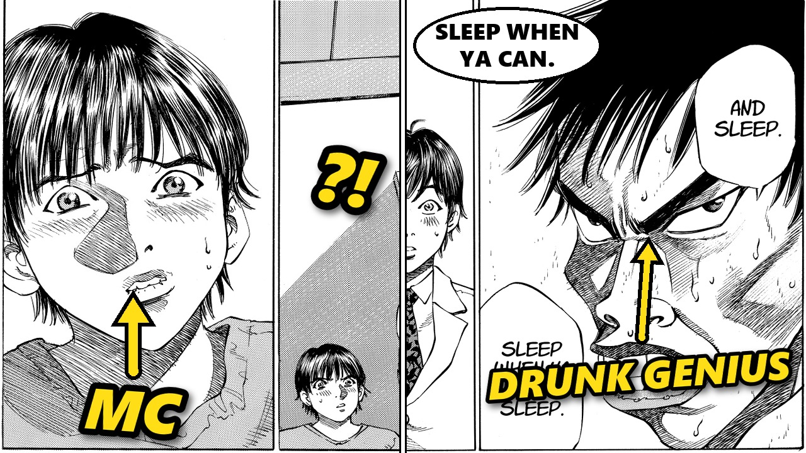

<p align="center">
  
</p>

<h1 align="center">Recap Studio</h1>

<p align="center">
  <b>Turn comics, manga and webtoons into narrated recap videos, on your own PC.</b>
</p>

<p align="center">
  <a href="https://github.com/iEatNoodlez/RecapStudio/releases/latest"></a>
  
  
  <a href="LICENSE"></a>
</p>

<p align="center">
  <a href="https://github.com/iEatNoodlez/RecapStudio/releases/latest"><b>Download</b></a> ·
  <a href="#make-a-recap">Make a recap</a> ·
  <a href="#how-it-works">How it works</a> ·
  <a href="#costs-and-privacy">Costs and privacy</a> ·
  <a href="docs/README.md">Documentation</a>
</p>

<p align="center">
  
</p>

<p align="center"><sub>The Script tab, with Episode 1 of <i>Give My Regards to Black Jack</i> by Shuho Sato: 56 pages became 61 narrated scenes and an 11-minute video. Sato lets anyone use the series freely (see <a href="#license-and-credits">credits</a>).</sub></p>

Add the chapters, press **Make the recap**, and Recap Studio cuts the pages into panels, reads the text, works out who's who, writes the narration, voices it and renders the video, with subtitles, YouTube chapters and a suggested title and thumbnail. No account, credits or watermark.

## Download

For Windows 10 or 11 and for Linux (64-bit), from the [Releases](https://github.com/iEatNoodlez/RecapStudio/releases) page. It comes in two editions, both free:

- **Lite** is the whole app.
- **Full Suite** is Lite with [Recap Studio's plugins](https://github.com/iEatNoodlez/RecapStudio-Plugins#readme) built in: finding the series, what's trending to make a project of, automation, posting to YouTube, branding, passing a site's Cloudflare check yourself in a window, and more languages and file types. Lite can add them one at a time, in Settings → Plugins.

| | Windows installer | Windows portable | Linux |
|---|---|---|---|
| Lite | `Recap-Studio-Lite-<version>-setup.exe` | `Recap-Studio-Lite-<version>-portable.zip` | `Recap-Studio-Lite-<version>-x86_64.AppImage` |
| Full Suite | `Recap-Studio-Full-Setup-<version>.exe` | `Recap-Studio-Full-Portable-<version>.zip` | `Recap-Studio-Full-<version>-x86_64.AppImage` |

The installer installs it for everyone on the PC or just for you. Unzip the portable copy anywhere you can write to, on a short path, and run `Recap Studio.exe`. Installing one edition over the other switches between them, and keeps your projects and settings.

On Linux (Ubuntu 22.04, Debian 12, Fedora 36 or newer), make the AppImage executable and start it: see [Linux](docs/linux.md).

**As a server** on a Linux machine you use from a browser (a NAS, a mini PC): [Recap Studio Server](https://github.com/iEatNoodlez/RecapStudio-Cloud) is the same app with no window, behind a login, installed as a service by one script.

Everything it needs is included. The first start downloads the voice model (354 MB) and walks you through a short setup. After that, the app checks for updates when it starts and installs them with one click.

## Make a recap

### 1. Create a project

Type a name at the top left and press **Create**, then answer a few questions: what kind of comic it is, how to find its characters, how the video looks, and the YouTube options. With the Find the series plugin, search for the series instead and it fills the project in for you, and the Trending finder suggests what to recap next.

<p align="center">
  
</p>

### 2. Add the chapters and press Make the recap

Press **Add chapters** and pick the series folder. Each subfolder of images, and each `.cbz` or `.zip`, becomes a chapter (and each `.epub`, with the EPUB comics plugin). You can also drop files on the window. **Make the recap** then runs every step on every chapter, and next time it carries on where it stopped. **Advanced mode** (bottom of the sidebar) shows every step and setting.

### 3. Check who's who

The character scan groups everyone who appears, and your script writer suggests their names from the story. Add them with a click, or let it add its own suggestions without asking.

<p align="center">
  
</p>

<p align="center"><sub>The hospital director appears 26 times but is never named in Episode 1, so he's left for you to name.</sub></p>

### 4. Read the script

The **Script** tab (at the top of this page) shows each scene's pictures, narration and voice line. Edit any line, play it, or leave a scene out.

### 5. Watch the video and take the title

The **Video** tab plays the recap. The project's `output` folder has `recap.mp4`, with its subtitles, the narration and a YouTube chapter list.

<p align="center">
  
</p>

Your script writer also suggests a clickbait title, a few others, and a thumbnail with labels and arrows on the characters, a "?!" and a speech bubble. Change the words or the pictures and it's drawn again, or press **Redraw with AI** to have an image model repaint it.

<p align="center">
  
</p>

<p align="center"><sub>Suggested with the title <i>I Made 2x My Salary in ONE Night… Then They Left Me Alone With a Dying Patient | Manga Recap</i>, and three others to pick from.</sub></p>

## How it works

| Step | What it does | With |
|---|---|---|
| Chapters | Imports folders, .zip and .cbz files, or gets chapters from sites through sources you bring (no scrapers come with the app): search one source or all of them at once, add a plugin list to install everything on it and keep it up to date, and pass a site's Cloudflare check yourself in a window. Checks for new chapters too. | Plugins you add, one at a time or a whole list; gallery-dl or Suwayomi if you run them; the Site check plugin |
| Panels | Cuts the pages into panels. Webtoons are stitched into one strip and cut at the gutters, around the speech bubbles. | OpenCV; ogkalu's comic text-and-bubble detector (optional download) |
| Text | Reads the speech bubbles and captions, in English, Korean, Chinese or Japanese. | RapidOCR; PaddleOCR's PP-OCRv5 for Korean, Chinese and Japanese (optional download) |
| Translate | Translates a Korean, Chinese or Japanese comic into English, and can letter the English into the bubbles. | Your script writer |
| Characters | Finds who's who and suggests their names, or takes the cast from AniList or Kitsu. | DeepGHS's detectors and CCIP, the WD tagger (optional download); AniList or Kitsu through the Find the series plugin |
| Script | Writes the narration a chapter at a time, from the pictures and the text. | A local model (Ollama), Claude Code on your Claude plan, or Claude, Gemini, OpenRouter, DeepSeek, Groq or Mistral with your own key |
| Voice | Reads the narration aloud, or uses your own recording. | Kokoro on your PC, Microsoft Edge's voices, or ElevenLabs |
| Title | Suggests a clickbait title and draws a labelled thumbnail, which an image model can repaint. | Your script writer; Gemini or OpenRouter image models |
| Video | Scrolls webtoons, pans and zooms other comics, crossfades, adds your background music, writes subtitles, can draw CapCut-style captions and cuts Shorts. | OpenCV and ffmpeg |

**Example Sources:** [RecapStudio-Sources](https://github.com/iEatNoodlez/RecapStudio-Sources) is a list of source plugins for some comic sites. It's kept apart from the app and isn't part of it. To try it, paste its link in Settings → Sources → Plugin lists. Using a source in line with a site's terms is up to you.

## Costs and privacy

Everything runs on your PC unless you choose an online service. A local model with Ollama and the Kokoro voice cost nothing. Online script writers, voices and the thumbnail redraw use your own API key, which is stored only on your PC, and that service bills you; with Claude, a chapter costs about 1¢ to 40¢ depending on the model. Claude Code uses your Claude subscription instead of API credit.

## Good to know

- **Speed**: with an NVIDIA card, text reading and the voice run several times faster (GPU support, a 1.3 GB download, offered in setup). An NVIDIA, AMD or Intel card also speeds up video encoding.
- **Space**: projects are saved in `Recap Studio` in your Documents folder, one folder each. A recap takes several GB.
- **Your phone**: scan a QR code in Settings to check the recaps from a phone on the same Wi-Fi, and run again one that stopped. Only your home network can reach it.
- **YouTube-safe**: for an age-restricted upload of an adult comic, this tones down sex scenes and covers nudity with black boxes. It can make mistakes, so check the video before you upload.

## Documentation

The [docs](docs/README.md) cover every feature in detail:

- [Install, files and updates](docs/install.md)
- [Linux](docs/linux.md)
- [Using Recap Studio](docs/using.md)
- [Script writers and the prompt](docs/script-writers.md)
- [Korean, Chinese and Japanese comics](docs/translation.md)
- [Characters](docs/characters.md)
- [Voice](docs/voice.md)
- [Video](docs/video.md)
- [YouTube title, thumbnail and YouTube-safe](docs/youtube.md)
- [Your phone](docs/phone.md)
- [Plugins](docs/plugins.md)
- [Getting chapters from sites](docs/sources.md)
- [The scan group's pages](docs/scan-group-pages.md)
- [Performance and the GPU](docs/performance.md)

## Run from source

With Python 3.10 or newer:

```powershell
powershell -ExecutionPolicy Bypass -File setup.ps1
```

Then double-click `run.bat`. Building the installer is covered in [Install, files and updates](docs/install.md#building-the-installer). On Linux, with Python 3.12 or newer: `./setup.sh`, then `./run.sh` ([Linux](docs/linux.md#running-from-source)).

## License and credits

MIT. The models it downloads have their own licenses, listed where the app offers them. Magi is for non-commercial use only.

The screenshots show Episode 1 of *Give My Regards to Black Jack* (ブラックジャックによろしく) by Shuho Sato, from Denshobato's English edition. Sato lets anyone copy, adapt and publish the series, commercially or not, without asking ([his report on the terms](https://note.com/shuho_sato/n/neda36a41a7b3), in Japanese). The narration, voice, title and thumbnail in them were made by Recap Studio, with Claude Code writing.
